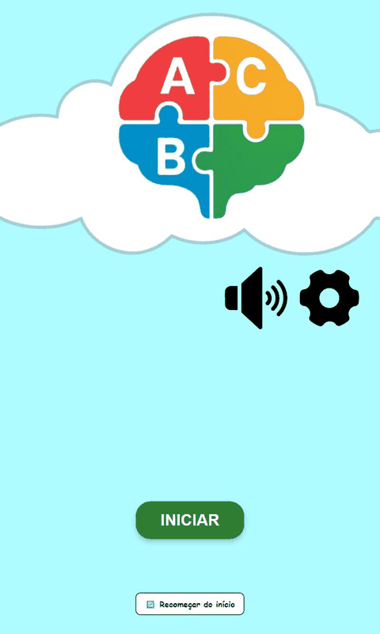
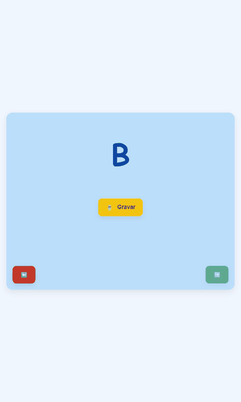
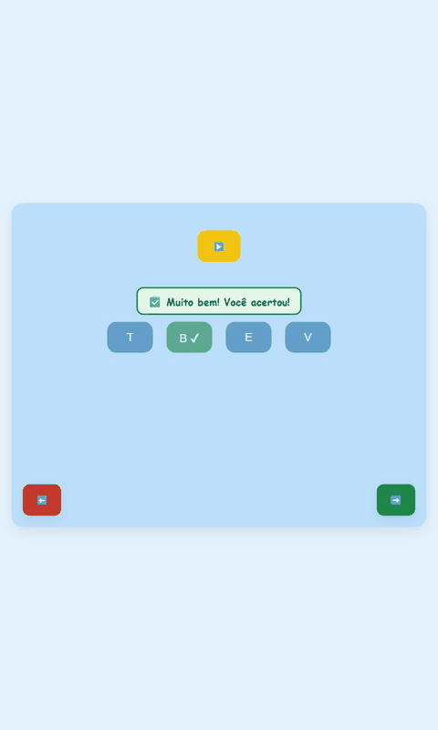

# Central do Alfabeto

> Read in English: [README.md](README.md)

[](https://github.com/Central-do-alfabeto/Central-do-Alfabeto-FrontEnd/actions/workflows/deploy.yml)

**Demonstração online: <https://central-do-alfabeto.github.io/Central-do-Alfabeto-FrontEnd/>**
(roda inteiramente no navegador, sem criar conta)

A Central do Alfabeto é um jogo de alfabetização por voz para crianças. A criança percorre o alfabeto letra por letra, ouvindo, escolhendo e falando, e recebe retorno visual e sonoro imediato. O projeto foi desenvolvido como projeto de extensão (Atividades de Extensão) do curso de Análise e Desenvolvimento de Sistemas do **IFSP, campus Campos do Jordão**. Quando há um backend disponível, o sistema também oferece contas e um painel do educador para acompanhar o progresso de cada aluno.

<p align="center">
  
  
  
</p>

## Sumário

- [Funcionalidades](#funcionalidades)
- [Compatibilidade de navegadores e privacidade](#compatibilidade-de-navegadores-e-privacidade)
- [Stack e arquitetura](#stack-e-arquitetura)
- [Instalação e execução](#instalação-e-execução)
- [Variáveis de ambiente](#variáveis-de-ambiente)
- [Scripts](#scripts)
- [Testes](#testes)
- [Implantação](#implantação)
- [Detalhes de implementação e limitações conhecidas](#detalhes-de-implementação-e-limitações-conhecidas)
- [Créditos](#créditos)

## Funcionalidades

- **Progressão de A a Z.** 26 fases, uma por letra, na ordem A, E, I, O, U, B, C, D, F, G, H, J, K, L, M, N, P, Q, R, S, T, V, W, X, Y, Z. Cada fase encadeia atividades curtas:
  - A: apresentação da letra, falar a letra, múltipla escolha.
  - E, I, O, U: o mesmo, mais falar três palavras.
  - Consoantes: o mesmo das vogais, mais cinco sílabas (a letra com cada vogal) antes das palavras.
  - Depois do Z há uma tela de conclusão.
- **Interface com áudio em primeiro lugar.** Por padrão as telas mostram ícones e tocam narração; o texto pode ser ativado nas configurações, junto com a paleta de cores (azul, vermelho ou verde).
- **Retorno visual e sonoro.** Acertos e erros mostram uma mensagem colorida com ícone e texto (anunciada a leitores de tela por `aria-live`) e tocam um som. As animações são desativadas quando o sistema pede movimento reduzido.
- **Três motores de reconhecimento de fala**, escolhidos em tempo de execução por trás de uma única abstração, `SpeechRecognizer`:
  1. **Web Speech API** (`SpeechRecognition` / `webkitSpeechRecognition`, `pt-BR`), o padrão quando o navegador suporta.
  2. **Servidor Vosk**: o endpoint `/audio/transcribe` do backend. É usado somente quando `VITE_API_URL` está definida e `VITE_SPEECH_ENGINE=server` foi configurada ou o navegador não tem a Web Speech API.
  3. **Modo assistido**: quando não há motor de reconhecimento, ou o microfone foi negado ou não existe, a tela explica a situação em linguagem simples e um adulto confirma com **"A criança falou certo"** ou **"Tentar de novo"**.
- **Regra de validação única.** Qualquer que seja o motor, a transcrição passa pela mesma comparação normalizada (veja os [detalhes](#detalhes-de-implementação-e-limitações-conhecidas)).
- **Voz sintetizada como alternativa.** Se um arquivo de narração não existe ou falha ao carregar, o texto é lido pela síntese de voz do navegador (`speechSynthesis`, `pt-BR`).
- **Modo demonstração** (sem `VITE_API_URL`): o app abre direto no menu do jogador, sem login nem cadastro, com o progresso salvo no `localStorage` e a opção **"Recomeçar do início"** com confirmação. Nenhuma requisição HTTP é feita.
- **Contas e painel do educador** (com backend): cadastro e login de alunos e educadores, progresso salvo por fase no servidor e um painel em que o educador vincula alunos e vê erros e repetições de áudio por fase.
- **Robustez e acessibilidade.** Página 404, tratamento de erros de renderização com botão de voltar ao início, mensagens de erro na tela em vez de `alert()`, nomes acessíveis nos botões de ícone, foco visível no teclado, contraste da paleta ajustado e layouts revisados em 360 px, 768 px e desktop.

## Compatibilidade de navegadores e privacidade

| Navegador | Web Speech API | O que a criança recebe |
| --- | --- | --- |
| Baseados em Chromium (Chrome, Edge, Opera, Brave...) | Suportada | Reconhecimento automático |
| Safari | Suportada | Reconhecimento automático |
| Firefox | Não suportada | Modo assistido (um adulto confirma), ou o servidor Vosk se houver backend configurado |

O suporte também depende da versão do navegador e do sistema operacional, e o microfone exige **HTTPS** (ou `localhost`).

**Nota de privacidade:** nos navegadores que suportam a Web Speech API, o áudio usado no reconhecimento pode ser processado por um serviço do fornecedor do navegador, fora desta aplicação. A aplicação em si não armazena nem envia a voz da criança a lugar nenhum quando esse motor é usado. Com o motor do servidor Vosk, o áudio gravado é enviado ao backend configurado.

## Stack e arquitetura

React 19, TypeScript 5.8, Vite 7, React Router 7, Axios, CSS Modules, Vitest e Testing Library, ESLint 9.

```text
src/
  assets/            imagens e CSS Modules (um por tela), global.css
  components/        RecordControl, Feedback, RestartProgress, ErrorBoundary
  config/env.ts      lê as variáveis VITE_* (modo demonstração, motor de fala preferido)
  hooks/             useSpeechCapture, useSectionRedirect, useOneShotAudio
  pages/             uma pasta por tela (atividades do jogo, menu, login, painel...)
  routes/            roteador (basename vindo de BASE_URL) e proteção de rotas
  services/
    api/             cliente Axios e chamadas HTTP (login, cadastro, progresso, alunos)
    progress/        ProgressService: implementações local (localStorage) e HTTP
    speech/          SpeechRecognizer: Web Speech, servidor Vosk e modo assistido
  state/, store/     preferências de interface, estado do jogo e conteúdo (letras, palavras)
  utils/             playAudio (arquivos + voz sintetizada), speechUtils (validação), phaseFlow
public/audio/        arquivos de narração (.mp3)
```

- **Abstração de fala.** `services/speech` define a interface `SpeechRecognizer` (`start`, `stop`, `abort`) com `WebSpeechRecognizer` e `ServerSpeechRecognizer`. `selectSpeechEngine` escolhe o motor a partir do ambiente e do navegador; `useSpeechCapture` expõe o estado ("ouvindo", "processando"), as mensagens de erro e a passagem para o modo assistido quando o microfone é negado. `RecordControl` desenha o botão de gravar, o estado e os botões do modo assistido.
- **Serviço de progresso.** As telas dependem só da interface `ProgressService` (`saveCompletedPhase`). `getProgressService()` devolve a implementação local (`localStorage`) no modo demonstração e a HTTP nos demais casos.
- **Roteamento com base path.** O `base` do Vite vem de `VITE_BASE_PATH` (ou da flag `--base`) e o `basename` do `BrowserRouter` vem de `import.meta.env.BASE_URL`. Os caminhos dos áudios também usam `BASE_URL`.
- **Conteúdo do jogo.** `store/gameConstants.ts` guarda as 26 letras (com os nomes falados aceitos) e três palavras por letra, indexadas pela letra. `utils/phaseFlow.ts` define a sequência de atividades.

## Instalação e execução

Requisitos: Node.js 20.19+ ou 22.12+ (a CI usa 22) e npm.

```bash
npm ci
npm run dev
```

Abra o endereço mostrado pelo Vite. Sem arquivo `.env` o app inicia em modo demonstração. Para usar o [backend](https://github.com/Central-do-alfabeto/Central-do-Alfabeto-Servidor), execute-o seguindo as instruções dele e crie um arquivo `.env`:

```bash
cp .env.example .env
# depois edite o .env e defina, por exemplo:
# VITE_API_URL=http://localhost:8080
```

O arquivo `.env` é ignorado pelo Git.

## Variáveis de ambiente

| Variável | Padrão | Descrição |
| --- | --- | --- |
| `VITE_API_URL` | vazio | URL do backend. Vazia ou ausente significa **modo demonstração**: sem contas, progresso local, sem chamadas HTTP. |
| `VITE_SPEECH_ENGINE` | vazio | Use `server` para preferir o servidor Vosk (só funciona com `VITE_API_URL` definida). Caso contrário, a Web Speech API é a preferida. |
| `VITE_BASE_PATH` | `/` | Subcaminho em que o site é servido (por exemplo `/Central-do-Alfabeto-FrontEnd/`). A flag `--base` do Vite tem prioridade. |

## Scripts

| Comando | O que faz |
| --- | --- |
| `npm run dev` | Servidor de desenvolvimento |
| `npm run build` | Verifica os tipos (`tsc -b`) e gera o build de produção em `dist/` |
| `npm run preview` | Serve o build de produção localmente |
| `npm run lint` | ESLint |
| `npm test` | Roda a suíte do Vitest uma vez e encerra |

## Testes

`npm test` executa o Vitest com jsdom e Testing Library. A suíte cobre, entre outros pontos: o alinhamento do conteúdo de A a Z e a progressão das fases, a validação de fala (incluindo falsos positivos), a voz sintetizada como alternativa, os motores de fala com `SpeechRecognition` simulado, o modo demonstração (nenhuma requisição HTTP, progresso local, redirecionamentos) e os principais componentes.

O ambiente de teste é fixado em `vite.config.ts`, então o resultado não depende de um `.env` local; cada teste declara o modo de que precisa com `vi.stubEnv("VITE_API_URL", ...)`.

## Implantação

O workflow [`.github/workflows/deploy.yml`](.github/workflows/deploy.yml) executa lint, testes e build a cada push e pull request. Em um push na `main`, ele também publica no GitHub Pages com as actions oficiais `configure-pages`, `upload-pages-artifact` e `deploy-pages`. A fonte do Pages deve estar configurada como **GitHub Actions** nas configurações do repositório.

- O site é compilado com `VITE_BASE_PATH=/Central-do-Alfabeto-FrontEnd/` e sem `VITE_API_URL`, então a versão publicada é a demonstração.
- O GitHub Pages não conhece as rotas do lado do cliente. Quando a base não é `/`, o build também grava o `404.html` como cópia do `index.html`, de modo que um link direto como `/PlayerMenu` ainda carrega o app.
- Para conferir localmente: `npm run build -- --base=/Central-do-Alfabeto-FrontEnd/` seguido de `npx vite preview --base=/Central-do-Alfabeto-FrontEnd/`.

**Usando um backend.** O backend fica em [Central-do-Alfabeto-Servidor](https://github.com/Central-do-alfabeto/Central-do-Alfabeto-Servidor). Execute-o, defina `VITE_API_URL` com o endereço dele no build ou no dev, e o app passa do modo demonstração para contas, painel do educador e progresso no servidor. Em produção o backend deve ser servido por HTTPS e aceitar requisições da origem do front-end.

## Detalhes de implementação e limitações conhecidas

- **Áudios de narração ausentes.** Alguns arquivos de áudio referenciados não existem em `public/audio`. Quando um arquivo falta ou falha ao carregar, `playAudio` lê o texto equivalente com a síntese de voz do navegador. A qualidade da voz depende das vozes instaladas no aparelho.
- **Validação de fala.** `utils/speechUtils.ts` converte para minúsculas, remove acentos e pontuação e compara a fala inteira com o alvo (uma frase inicial como "a letra" ou "a palavra" é permitida). Letras aceitam a letra ou o nome falado dela; sílabas aceitam variantes de grafia do mesmo som (por exemplo "xa" e "cha"); palavras aceitam alternativas cadastradas e uma tolerância pequena: igualdade exata até 4 letras, 1 edição de 5 a 8 letras e 2 edições a partir de 9 letras. Não há busca por trecho. A comparação é rigorosa, e os reconhecedores erram mais com letras isoladas e vozes infantis, por isso o modo assistido continua disponível.
- **Reprodução de áudio.** Só uma narração toca por vez: iniciar outra para a anterior (arquivo ou voz sintetizada), e sair de uma tela para a narração dela.
- **Concluir uma fase.** A tela de parabéns salva a fase registrada ao fim da última atividade. Recarregá-la não salva nem avança de novo, e abrir a URL sem ter concluído uma fase não concede progresso.
- **Sessão expirada.** Com backend, um 401 (ou um 403 sem corpo de erro) em requisição autenticada limpa a sessão e leva ao login com um aviso de sessão expirada. Um 403 com corpo de erro é tratado como erro de permissão comum.
- **Sílabas.** As sílabas são a letra seguida de cada vogal, então algumas são artificiais em português (por exemplo as de Q, K, W e Y).
- **Reprodução automática.** Os navegadores podem bloquear áudio que começa sem um gesto do usuário. Nesse caso a narração não é forçada; a criança pode apertar o botão de som.
- **Painel do educador.** Precisa de backend e não está disponível no modo demonstração. Nesse modo, `/Login`, `/Register` e `/EducatorDashboard` redirecionam para o jogo.
- **Progresso local.** Fica no `localStorage` do navegador: é por aparelho e navegador, e se perde se os dados do site forem apagados.
- **Fontes.** O jogo usa a pilha de fontes com Comic Sans MS, que não está instalada em todos os sistemas.
- **Dependências.** O `npm audit` aponta 7 vulnerabilidades moderadas, todas em dependências apenas de desenvolvimento (`minimatch`, via `typescript-eslint`); a correção exige `npm audit fix --force`, que não foi aplicado. Elas não chegam ao pacote de produção.

## Créditos

Desenvolvido pelos alunos do curso de Análise e Desenvolvimento de Sistemas do IFSP Campos do Jordão, como projeto de extensão:

- Brian Gustavo de Oliveira Brandão
- Tiago J. Saraiva
- Luiz Henrique Freitas
- Arthur Brandino

Nomes obtidos do histórico de commits do repositório.
