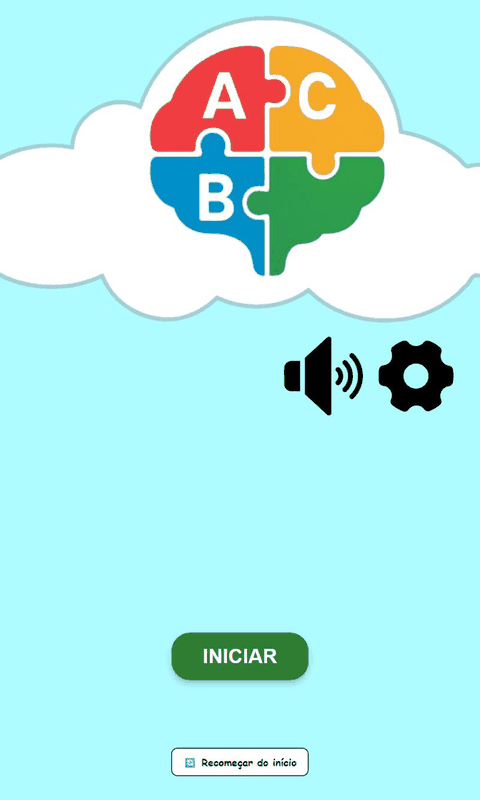
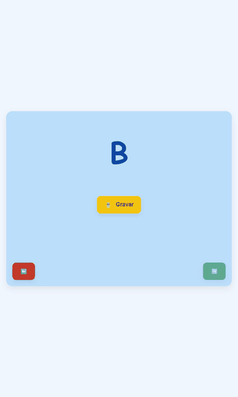
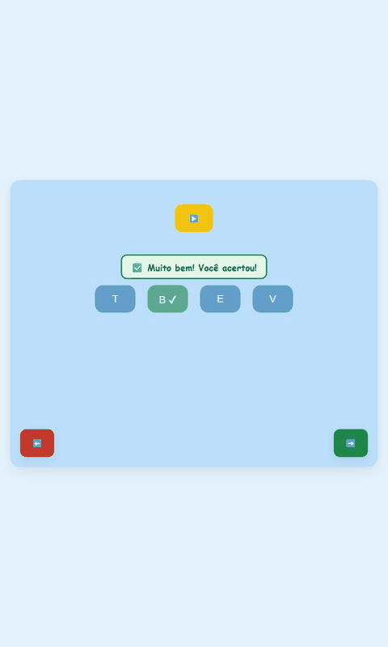

# Central do Alfabeto

> Leia em português: [LEIA-ME.md](LEIA-ME.md)

[](https://github.com/Central-do-alfabeto/Central-do-Alfabeto-FrontEnd/actions/workflows/deploy.yml)

**Live demo: <https://central-do-alfabeto.github.io/Central-do-Alfabeto-FrontEnd/>**
(runs entirely in the browser, no account needed)

Central do Alfabeto is a voice-based literacy game for children. The child walks through the alphabet letter by letter, listening, choosing and speaking, and gets immediate visual and audio feedback. It was built as an extension project (*Atividades de Extensão*) of the Systems Analysis and Development course at **IFSP, Campos do Jordão campus**. When a backend is available, it also provides accounts and an educator dashboard to follow each student's progress.

<p align="center">
  
  
  
</p>

## Contents

- [Features](#features)
- [Browser compatibility and privacy](#browser-compatibility-and-privacy)
- [Stack and architecture](#stack-and-architecture)
- [Getting started](#getting-started)
- [Environment variables](#environment-variables)
- [Scripts](#scripts)
- [Tests](#tests)
- [Deployment](#deployment)
- [Implementation details and known limitations](#implementation-details-and-known-limitations)
- [Credits](#credits)

## Features

- **A to Z progression.** 26 phases, one per letter, in the order A, E, I, O, U, B, C, D, F, G, H, J, K, L, M, N, P, Q, R, S, T, V, W, X, Y, Z. Each phase chains short activities:
  - A: letter presentation, say the letter, multiple choice.
  - E, I, O, U: the same, plus saying three words.
  - Consonants: the same as the vowels, plus five syllables (the letter with each vowel) before the words.
  - After Z there is a completion screen.
- **Audio-first interface.** By default the screens show icons and play narration; text can be turned on in the settings screen, together with the colour palette (blue, red or green).
- **Visual and audio feedback.** Correct and wrong answers show a coloured message with an icon and text (announced to screen readers through `aria-live`) and play a sound. Animations are disabled when the system asks for reduced motion.
- **Three speech recognition engines**, chosen at run time behind a single `SpeechRecognizer` abstraction:
  1. **Web Speech API** (`SpeechRecognition` / `webkitSpeechRecognition`, `pt-BR`), the default when the browser supports it.
  2. **Vosk server**: the backend `/audio/transcribe` endpoint. It is used only when `VITE_API_URL` is set and either `VITE_SPEECH_ENGINE=server` is set or the browser has no Web Speech API.
  3. **Assisted mode**: when there is no recognition engine, or the microphone is denied or missing, the screen explains the situation in plain language and an adult confirms with **"A criança falou certo"** (the child spoke correctly) or **"Tentar de novo"** (try again).
- **Single validation rule.** Whatever the engine, the transcript goes through the same normalised comparison (see [details](#implementation-details-and-known-limitations)).
- **Synthesised voice fallback.** If a narration file is missing or fails to load, the text is read by the browser speech synthesis (`speechSynthesis`, `pt-BR`).
- **Demo mode** (no `VITE_API_URL`): the app opens straight into the player menu, no login or sign-up, progress saved in `localStorage`, and a **"Recomeçar do início"** (restart) option with confirmation. No HTTP request is made.
- **Accounts and educator dashboard** (with a backend): sign-up and login for students and educators, progress saved per phase on the server, and a dashboard where the educator links students and sees errors and audio repetitions per phase.
- **Robustness and accessibility.** 404 page, error boundary with a "back to start" button, on-screen error messages instead of `alert()`, accessible names on icon buttons, visible keyboard focus, palette contrast adjusted and layouts reviewed at 360 px, 768 px and desktop widths.

## Browser compatibility and privacy

| Browser | Web Speech API | What the child gets |
| --- | --- | --- |
| Chromium-based (Chrome, Edge, Opera, Brave...) | Supported | Automatic recognition |
| Safari | Supported | Automatic recognition |
| Firefox | Not supported | Assisted mode (an adult confirms), or the Vosk server if a backend is configured |

Support also depends on the browser version and operating system, and the microphone requires **HTTPS** (or `localhost`).

**Privacy note:** in the browsers that support the Web Speech API, the audio used for recognition may be processed by a service of the browser vendor, outside this application. The application itself does not store or send the child's voice anywhere when this engine is used. With the Vosk server engine, the recorded audio is sent to the configured backend.

## Stack and architecture

React 19, TypeScript 5.8, Vite 7, React Router 7, Axios, CSS Modules, Vitest and Testing Library, ESLint 9.

```text
src/
  assets/            images and CSS Modules (one per screen), global.css
  components/        RecordControl, Feedback, RestartProgress, ErrorBoundary
  config/env.ts      reads VITE_* variables (demo mode, preferred speech engine)
  hooks/             useSpeechCapture, useSectionRedirect, useOneShotAudio
  pages/             one folder per screen (game sections, menu, login, dashboard...)
  routes/            router (basename from BASE_URL) and route guards
  services/
    api/             Axios client and HTTP calls (login, sign-up, progress, students)
    progress/        ProgressService: local (localStorage) x HTTP implementations
    speech/          SpeechRecognizer: Web Speech, Vosk server and assisted mode
  state/, store/     UI preferences, game state and the game content (letters, words)
  utils/             playAudio (files + synthesised fallback), speechUtils (validation), phaseFlow
public/audio/        narration files (.mp3)
```

- **Speech abstraction.** `services/speech` defines the `SpeechRecognizer` interface (`start`, `stop`, `abort`) with `WebSpeechRecognizer` and `ServerSpeechRecognizer`. `selectSpeechEngine` picks the engine from the environment and the browser; `useSpeechCapture` exposes the state ("listening", "processing"), error messages and the switch to assisted mode when the microphone is denied. `RecordControl` renders the record button, the status and the assisted-mode buttons.
- **Progress service.** The screens depend only on the `ProgressService` interface (`saveCompletedPhase`). `getProgressService()` returns the local implementation (`localStorage`) in demo mode and the HTTP implementation otherwise.
- **Routing with base path.** Vite's `base` comes from `VITE_BASE_PATH` (or the `--base` flag) and the `BrowserRouter` `basename` comes from `import.meta.env.BASE_URL`. Audio paths also use `BASE_URL`.
- **Game content.** `store/gameConstants.ts` holds the 26 letters (with accepted spoken names) and three words per letter, indexed by letter. `utils/phaseFlow.ts` defines the sequence of activities.

## Getting started

Requirements: Node.js 20.19+ or 22.12+ (the CI uses 22) and npm.

```bash
npm ci
npm run dev
```

Open the address printed by Vite. Without a `.env` file the app starts in demo mode. To use the [backend](https://github.com/Central-do-alfabeto/Central-do-Alfabeto-Servidor), run it following its instructions and create a `.env` file:

```bash
cp .env.example .env
# then edit .env and set, for example:
# VITE_API_URL=http://localhost:8080
```

The `.env` file is ignored by Git.

## Environment variables

| Variable | Default | Description |
| --- | --- | --- |
| `VITE_API_URL` | empty | Backend URL. Empty or missing means **demo mode**: no accounts, local progress, no HTTP calls. |
| `VITE_SPEECH_ENGINE` | empty | Set to `server` to prefer the Vosk server (only works when `VITE_API_URL` is set). Otherwise the Web Speech API is preferred. |
| `VITE_BASE_PATH` | `/` | Sub-path where the site is served (for example `/Central-do-Alfabeto-FrontEnd/`). The `--base` flag of Vite overrides it. |

## Scripts

| Command | What it does |
| --- | --- |
| `npm run dev` | Development server |
| `npm run build` | Type-check (`tsc -b`) and production build into `dist/` |
| `npm run preview` | Serves the production build locally |
| `npm run lint` | ESLint |
| `npm test` | Runs the Vitest suite once and exits |

## Tests

`npm test` runs Vitest with jsdom and Testing Library. The suite covers, among other things: content alignment for A to Z and the phase progression, speech validation (including false positives), the synthesised-voice fallback, the speech engines with a mocked `SpeechRecognition`, demo mode (no HTTP request, local progress, redirects) and the main components.

The test environment is fixed in `vite.config.ts`, so results do not depend on a local `.env`; each test declares the mode it needs with `vi.stubEnv("VITE_API_URL", ...)`.

## Deployment

The workflow [`.github/workflows/deploy.yml`](.github/workflows/deploy.yml) runs lint, tests and build on every push and pull request. On a push to `main` it also publishes to GitHub Pages with the official `configure-pages`, `upload-pages-artifact` and `deploy-pages` actions. The Pages source must be set to **GitHub Actions** in the repository settings.

- The site is built with `VITE_BASE_PATH=/Central-do-Alfabeto-FrontEnd/` and without `VITE_API_URL`, so the published version is the demo.
- GitHub Pages does not know the client-side routes. When the base is not `/`, the build also writes `404.html` as a copy of `index.html`, so a direct link such as `/PlayerMenu` still loads the app.
- To check locally: `npm run build -- --base=/Central-do-Alfabeto-FrontEnd/` followed by `npx vite preview --base=/Central-do-Alfabeto-FrontEnd/`.

**Using a backend.** The backend lives in [Central-do-Alfabeto-Servidor](https://github.com/Central-do-alfabeto/Central-do-Alfabeto-Servidor). Run it, set `VITE_API_URL` to its address at build or dev time, and the app switches from demo mode to accounts, educator dashboard and server-side progress. The backend must be served over HTTPS in production and allow requests from the front-end origin.

## Implementation details and known limitations

- **Missing narration files.** Some referenced audio files do not exist in `public/audio`. When a file is missing or fails to load, `playAudio` reads the equivalent text with the browser speech synthesis. The voice quality depends on the voices installed on the device.
- **Speech validation.** `utils/speechUtils.ts` lowercases, removes accents and punctuation and compares the whole utterance against the target (a leading phrase such as "a letra" or "a palavra" is allowed). Letters accept the letter or its spoken name; syllables accept spelling variants of the same sound (for example "xa" and "cha"); words accept registered alternatives and a small tolerance: exact match up to 4 letters, 1 edit for 5 to 8 letters, 2 edits from 9 letters. There is no substring search. The matching is strict, and recognisers are less accurate with isolated letters and children's voices, so assisted mode remains available.
- **Audio playback.** Only one narration plays at a time: starting another stops the previous one (file or synthesised voice), and leaving a screen stops its narration.
- **Completing a phase.** The congratulations screen saves the phase recorded when the last activity ended. Reloading it does not save or advance again, and opening its URL without having finished a phase grants no progress.
- **Expired session.** With a backend, a 401 (or a 403 without an error body) on an authenticated request clears the session and sends the user to the login screen with an "expired session" notice. A 403 with an error body is treated as a regular permission error.
- **Syllables.** Syllables are the letter followed by each vowel, so some are artificial in Portuguese (for example for Q, K, W and Y).
- **Autoplay.** Browsers can block audio that starts without a user gesture. In that case the narration is not forced; the child can press the sound button.
- **Educator dashboard.** It needs a backend and is not available in demo mode. In demo mode `/Login`, `/Register` and `/EducatorDashboard` redirect to the game.
- **Local progress.** It lives in the browser's `localStorage`: it is per device and browser, and is lost if the site data is cleared.
- **Fonts.** The game uses the Comic Sans MS font stack, which is not installed on every system.
- **Dependencies.** `npm audit` reports 7 moderate vulnerabilities, all in development-only dependencies (`minimatch` through `typescript-eslint`); fixing them requires `npm audit fix --force`, which was not applied. They do not reach the production bundle.

## Credits

Developed by the students of the Systems Analysis and Development course at IFSP Campos do Jordão, as an extension project:

- Brian Gustavo de Oliveira Brandão
- Tiago J. Saraiva
- Luiz Henrique Freitas
- Arthur Brandino

Names taken from the repository's commit history.
